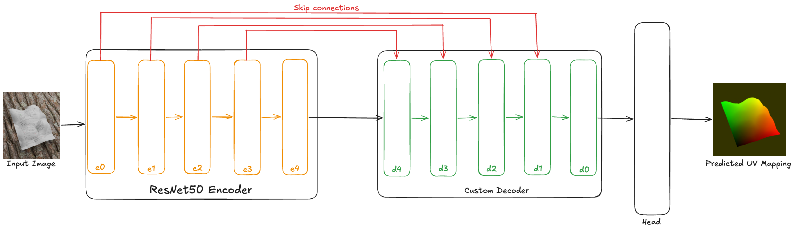
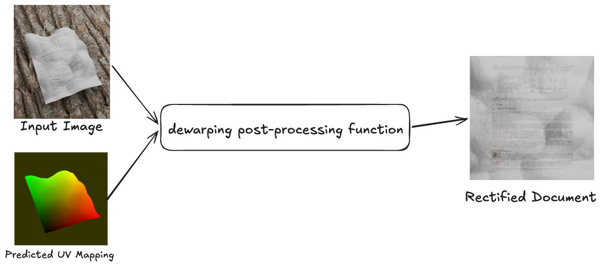
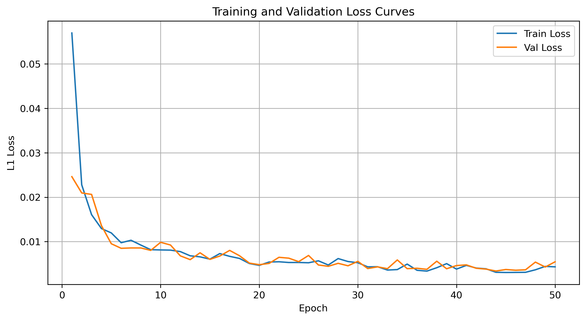
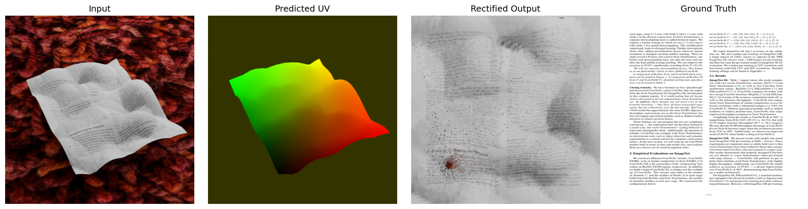

# deep-document-unwarping
final project for CS 132 Computer Vision

### 1. Architecture

The architecture of my model uses a pretrained ResNet50 as the encoder. The features of each of its stages are fed into a U-Net style decoder with skip connections, where each stage upsamples and concatenates the corresponding features from the encoder and then applies a convolutional block with a ReLU activation. The final layer is a convolutional layer that produces a 2-channel UV flow field, which is returned directly by the model. The UV map represents a mapping where each pixel encodes the (u, v) coordinate on the final flat document surface that the corresponding input pixel maps to. The UV map is then fed into a dewarping function to rectify the image as a deterministic post-processing step which is not learned. The model is directly supervised on the provided ground truth UV mappings, as opposed to a comparison between the rectified image from the produced UV map and the ground truth rectified image.

*Figure 1: Model Architecture*

*Figure 2: Dewarping*

### 2. Loss Function

The model was trained directly using the provided ground truth UV maps, and uses L1 loss. Prior to this approach, several alternative approaches were explored. First, a from-scratch encoder-decoder was trained using various loss functions (SSIM and MSE, both computed on the rectified output), and in both cases the predicted flow field lacked any meaningful structure, producing outputs with vaguely document-shaped blobs in some cases or in other cases purely meaningless blobs. Then, I switched to a pretrained encoder and experimented again with SSIM and masked losses (L1 and MSE), but these attempts once again failed to produce meaningful UV maps, often producing uniform gradients or messy UV maps with blobs. Ultimately, directly supervising on the UV map itself with L1 loss provided by far the best result. Training directly on the UV maps allows the model to avoid attempting to learn to rectify lighting effects (shadows, shading, etc.) which the model itself cannot correct for. Computing loss on the rectified output penalizes the model for the lighting effects present in the input, and can possibly cause it to seek other ways of minimizing the loss as opposed to producing a high quality UV mapping. I saw the effects of this in one of my earlier attempts using SSIM loss - in an attempt to avoid penalization for these lighting effects, the model learned to sample every pixel from a generally bright region of the image, ignoring the document structure, and this produced vague white blobs that did not resemble the actual document. Switching to supervising the UV mapping directly avoided this issue.

*Figure 3: Training and Validation loss curves. The model was trained with L1 loss by directly supervising the UV maps. The training process uses the input data at size 512 ×512, with an AdamW optimizer at a learning rate of 1 ×10−4with a weight decay of 0.01. The loss has essentially reached convergence by epoch 30, and only marginally improves from that point on. The final minimum for L1 loss on validation data is 0.0034 in epoch 44.*

### 3. Results

Figure 4 shows a sample output UV map from the model and the resulting rectified document produced by feeding the UV prediction through the dewarp with uv function in the provided starter code, as well as the ground truth document. The rectified image does show that the document structure is largely recovered, with lines of text appearing roughly horizontal and the corners of the page being reasonably well aligned. However, the rectified document does contain blurring and artifacts, which occur due to the lighting effects present in the input images (shadows, shading, etc.), and cannot be corrected simply by geometric dewarping. The model’s predicted UV map shows a smooth gradient across the surface of the document.

*Figure 4: Comparison of input, predicted UV map, rectified output, and ground truth for a sample document.*

### 4. Metrics

To calculate the SSIM score, the validation set from training (at a 80:20 split) was split in half to create a heldout set. While this is not quite the same as a completely held out test set from the start of training since the split was done post-hoc, to avoid re-training the model completely this method was used as an approximation of that. The examples in this test split were only used in validation which impacts which epoch we decide to use for our final model (ie early stopping), and are not directly used to update the model itself during training. The model achieves a SSIM score of 0.4431 on this heldout set of 170 images. As a point of reference, warping the ground truth UV map provided and calculating the SSIM score of that rectified image with the ground truth yields a SSIM score of 0.5270, which serves as an upper bound of possible performance using this UV supervision approach without any additional techniques for fixing lighting effects. Directly computing the SSIM score of the raw input image and the ground truth yields a SSIM score of 0.2298. Therefore, the model has learned to capture about 72% of the possible SSIM improvement from no processing to dewarping with the perfect UV maps. By L1 loss, the best value achieved on the validation split was 0.0034 in epoch number 44 of 50.

### 5. Running the code

The repository contains a few runnable scripts:

- **inference.py**: processes a provided input folder of images, runs them through the network and saves rectified versions along with the predicted UV maps. Example usage (only input dir is required):
  `python inference.py --input_dir <path-to-your-input-folder> --output_dir <path-to-where-you-want-results> --weights best_model.pth`

- **evaluate.py**: computes the SSIM metric on the dataset, by splitting the validation split in half (none of the arguments are required, all have defaults). This will create a txt file containing the average SSIM on the heldout data, as well as write the individual SSIM number for each image.
  `python evaluate.py --input_dir <path-to-dataset-input> --output <path-to-where-you-want-results> --weights best_model.pth`

Importantly, the repository contains a few dependencies required to run: `torch, torchvision, timm, pytorch-mssim, numpy, matplotlib`

Also included in the submission is a small selection (20) of images from the training set and their resulting UV predictions and rectified images. This is available in the **sample-output** directory.

